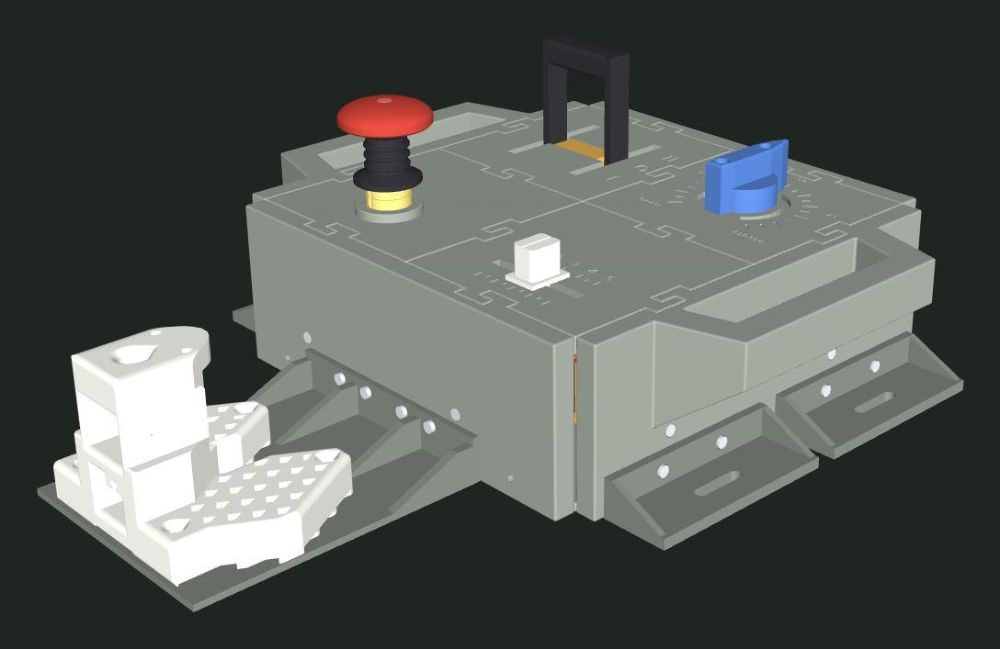
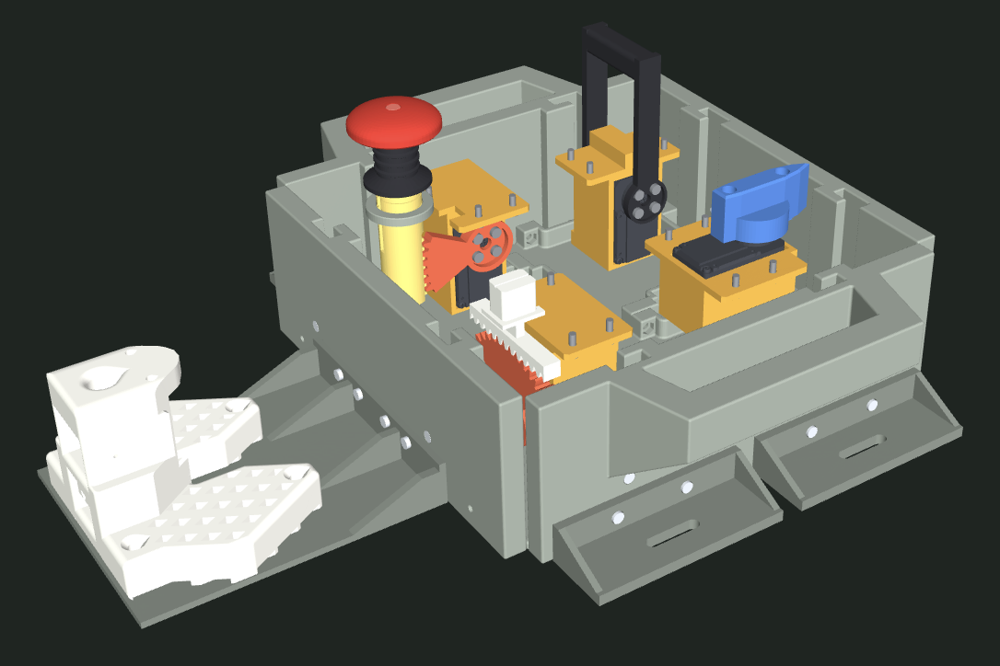
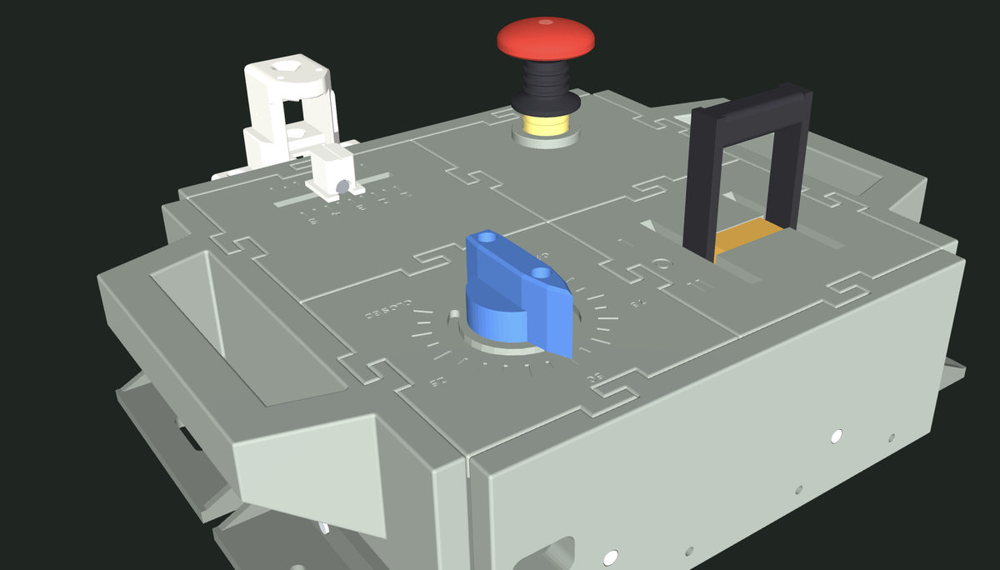
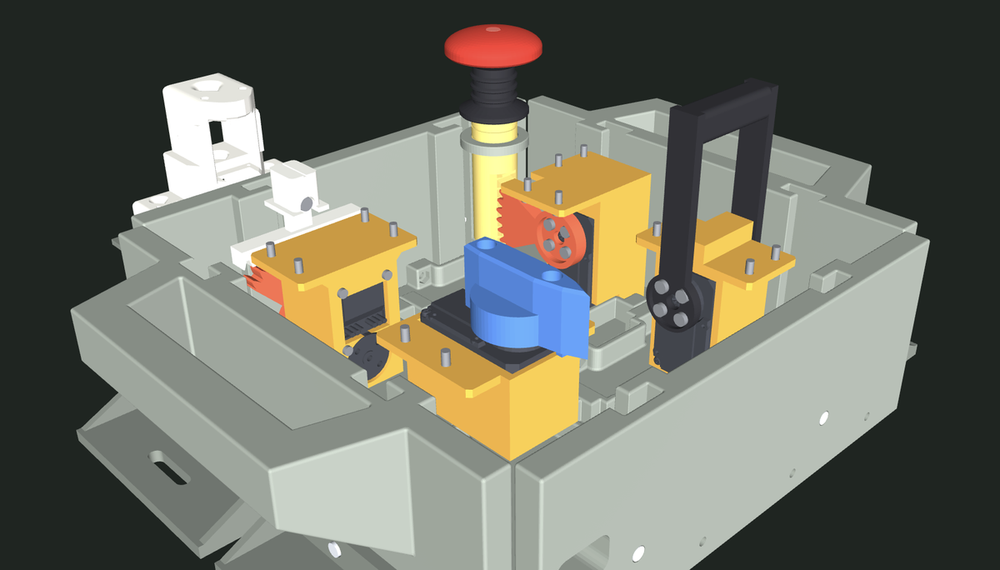

# LeBox

An open-source, self-resetting, self-scoring test bench for robot manipulation policies.

<p align="center">
  
</p>
<p align="center"><em>LeBox v0.2 (CAD render). The white part is the base of an SO-101 arm on the tie bar that fixes the arm to the box.</em></p>

Evaluating a policy on a real robot usually needs a person to put the scene back after every episode and to judge whether the episode worked. LeBox removes both jobs. It is a 2 x 2 board of four modules: a knife switch, a valve handle, a push-pull plunger and a slider. Each module is coupled to one Feetech STS3215 bus servo that does three things:

- **torque off:** a passive, back-drivable joint the robot operates
- **encoder:** ground-truth state for scoring, with no camera or classifier
- **torque on:** resets the module to any commanded or randomised start state

LeBox is built for [LeRobot](https://github.com/huggingface/lerobot) and the SO-101 arm.

<p align="center">
  
</p>
<p align="center"><em>Tiles removed: one servo, in its orange cassette, under each module. The plunger and slider run on sector gears; the switch and valve are direct drive.</em></p>

| With tiles | Without tiles |
|---|---|
|  |  |

The images are renders of the v0.2 design, not photos of a built box.

## Status

Early. The host software runs end to end on a simulated board. The driver for real servos is written but has only been tested against an emulated servo; [docs/bench-day.md](docs/bench-day.md) is the plan for its first run on hardware.

| Piece | State |
|---|---|
| Module descriptors and unit scales | done |
| Calibration file (save, load, sanity check) | done |
| Board: read every module in real units | done |
| Simulated servo bus | done |
| `lebox monitor --sim` | done |
| Feetech bus driver (`lebox ports`, `ping`, `setup-motors`) | written; not yet run on real servos |
| Safe motion: `lebox move`, `reset`, `selftest` | done on the simulator; not yet run on real servos |
| `lebox calibrate --bench` (loose servos, no stops) | done on the simulator |
| Calibration against the printed hard stops | not started; needs the printed parts |
| Task files: one step or many, reach and hold steps, several wordings, table import; 13 built-in tasks | done |
| Step codes: a task on one line, e.g. `C0 A2 D4 AS B0` | done |
| LeBox Standard Test v1.0: 39 tasks in three levels, run and reported with `lebox suite` | done on the simulator |
| Scorer and trace files | done |
| `lebox task list`, `show`, `check` and `lebox score` | done |
| `lebox task run`: reset, then score an episode live | done on the simulator |
| `lebox-record` and the `lerobot-rollout` strategy | not started |

The design is in [docs/software-spec.md](docs/software-spec.md).

## Try it

Python 3.10 or newer. Dependencies: PyYAML and pyserial.

```bash
pip install -e ".[dev]"
lebox monitor --sim
```

```text
LeBox monitor: simulated board, design-value calibration
module    id    raw       value  at      low stop to high stop
switch     1   2442   +34.6 deg  -       |----------------------o--|
dial       2   3083      83.7 %  -       |--------------------o----|
plunger    3   2145        3.03  3       |------------------o------|
slider     4   2211        3.90  4       |-----------------o-------|
```

`--once` prints a single reading; `--frames N` prints N. Every command that touches a board takes `--sim` for the simulated board or `--port` for a real one.

The whole loop on the simulator, with a simulated hand playing the robot:

```bash
lebox task run --sim slider_to_3 --seed 1
```

```text
slider_to_3: start state in place (slider at 2). Board passive.
Instruction: "Move the slider to 3"
slider_to_3: success
  duration       1.9 s
  time to goal   0.9 s
  progress       100% (best 100%)
  final error    slider 0
  moved          slider
  disturbed      -
```

Run the tests with `pytest`.

## Scales

Each module reads in the units printed on its tile.

| Module | Servo ID | Scale | Markings |
|---|---|---|---|
| switch | 1 | degrees, -40 to +40 | I, O, II |
| dial | 2 | percent open, 0 to 100 | CLOSED, 25, 50, 75, OPEN |
| plunger | 3 | ring number, 0 to 4 | 0 to 4 |
| slider | 4 | mark number, 1 to 5 | 1 to 5 |

The scale is linear between the two hard stops. The software commands and scores in a working range slightly inside the stops.

## Tasks and scoring

A task says what the robot is asked to do and what counts as done. [docs/tasks.md](docs/tasks.md) is the full reference. A one-step task is a short YAML file:

```yaml
name: slider_to_3
instruction: "Move the slider to 3"
start:
  slider: {sample: [1, 2, 4, 5]}   # where the slider is put before each episode
goal:
  slider: {target: 3, tol: 0.15}
others: unchanged                  # touching any other module is a side effect
hold_s: 1.0                        # the goal must hold this long
timeout_s: 30
```

```bash
lebox task list                  # the 13 built-in tasks
lebox board                      # modules, servo ids, names and scales
lebox task show slider_to_3      # what a task asks for
lebox task check my_task.yaml    # check your own task file for mistakes
```

A longer task is a list of steps. A step either reaches a goal or holds still for a time, and the robot gets the whole instruction up front:

```yaml
name: valve_wait_slider
start:
  dial: {range: [0, 30]}
  slider: {sample: [1, 2]}
steps:
  - say: ["Turn the blue valve to 50%", "Set the blue valve half open"]
    reach: {dial: 50}
    within_s: 20
  - say: "Wait 30 seconds"
    hold_s: 30
    early_s: 5
  - say: "Slide the slider to 5"
    reach: {slider: 5}
    within_s: 20
```

The steps are the definition of the task; `say` is only the wording, and one of the alternatives is picked per episode. A fixed description is generated from the steps (`dial=50±3 within 20s | hold 30s (-5s) | slider=5±0.15 within 20s`), so results can be grouped whatever the wording. Tasks can also be written as a table and imported with `lebox task import`.

Every standard step also has a short code, the tile letter and the number printed on the tile, so a whole task fits on one line:

```bash
lebox codes                                             # the 18 standard steps and their wordings
lebox task run --sim "A1 B100 C4 D1 > C0 A2 D4 AS B0"   # start state > steps
```

The LeBox Standard Test is a frozen set of 39 such tasks in three levels (one action, two or three, five or more) for comparing policies:

```bash
lebox suite list
lebox suite run --sim --out runs/demo --episodes 1
```

An episode is recorded as a trace: the position of every module over time, straight from the encoders. The outcome is computed from the task and the trace, never labelled by hand, so the same trace always scores the same and can be scored again later under a different definition.

```bash
lebox score slider_to_3 episode.jsonl
```

```text
slider_to_3: side_effect
  duration       30.0 s
  progress       100% (best 100%)
  final error    slider 0
  moved          dial, slider
  disturbed      dial
```

| Outcome | Meaning |
|---|---|
| `success` | goal reached and held, nothing else disturbed |
| `late` | in the goal when the episode ended, but not yet held long enough |
| `side_effect` | goal reached, but another module was moved and left displaced |
| `overshoot` | the goal was reached at some point but not held |
| `partial` | a goal module was moved, the goal was never reached |
| `wrong_module` | only modules that are not part of the goal were moved |
| `wrong_order` | a later step was carried out before the present one |
| `too_early` | the robot moved on before a wait was over |
| `no_contact` | nothing moved |
| `aborted` | the episode was stopped from outside |

## On real servos

Not yet run on hardware; [docs/bench-day.md](docs/bench-day.md) is the first-run plan, and it starts with read-only checks.

```bash
lebox ports                                  # find the servo adapter
lebox ping --port /dev/ttyACM0               # read only: who is on the bus
lebox setup-motors --port /dev/ttyACM0       # ids 1-4 and a stored torque cap, one servo at a time
lebox calibrate --bench --port /dev/ttyACM0  # loose servos: present position becomes mid-travel
lebox monitor --port /dev/ttyACM0
lebox move --port /dev/ttyACM0 slider=3
lebox task run --port /dev/ttyACM0 slider_to_3
```

Every move follows the same safety rules: it refuses to start unless the servo has a stored torque cap, sets and reads back a low torque limit, creeps a few degrees at a time, releases at once if the servo stalls, and always ends with torque off.

## Using it from Python

```python
from lebox import Board, Calibration, SimBus

calibration = Calibration.from_design()      # design values, for simulation only
bus = SimBus.for_board(calibration, start={"slider": 2.0})
board = Board(bus, calibration)

board.passive()                              # torque off: modules can be moved
values = {name: round(value, 2) for name, value in board.values().items()}
print(values)                                # {'switch': 0.0, 'dial': 50.0, 'plunger': 2.0, 'slider': 2.0}
print(board.read()["slider"].label)          # 2
```

## Licence

MIT. The LeBox hardware builds on Microsoft's BusyBox (MIT) and on the SO-ARM100 (Apache-2.0); their licence texts ship with the hardware files.
